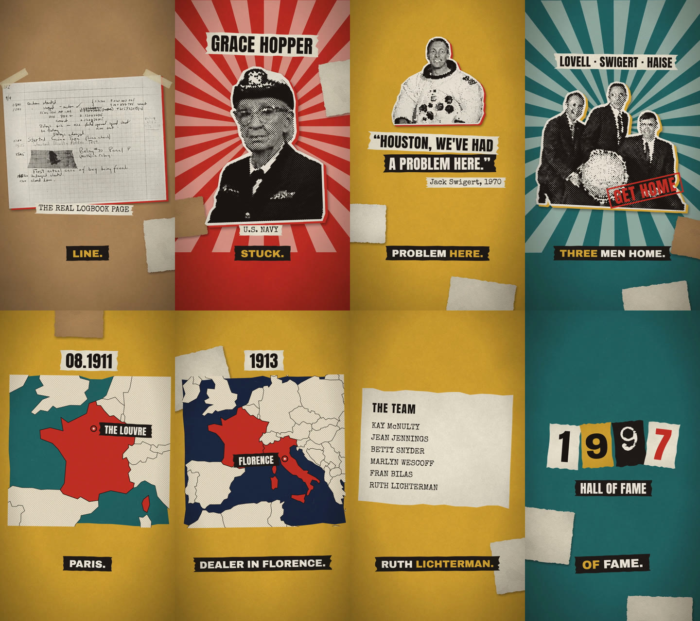
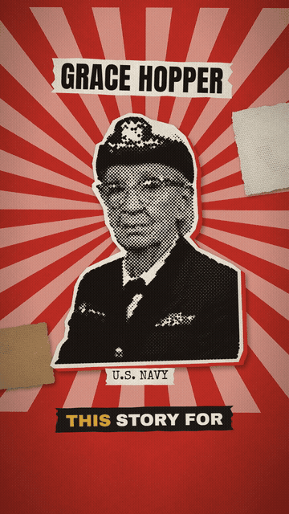
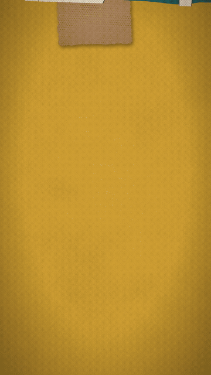

# papercut

**Vox-style paper-collage documentaries, made by Claude, for free, on your own computer.**

One topic in, one finished vertical short out: halftone cut-outs, torn paper, rubber stamps, maps, typewriter documents, stop-motion on twos, paper sound effects, captions and a voice. No video model, no image model, no credits.



<p>


</p>

## How it works

AI video tools invent the picture, and every clip costs credits. papercut builds the picture instead, from real archive photos and code:

1. **Claude** checks the facts, writes a 10-14 beat script and picks the photos.
2. **Wikimedia Commons** supplies the photos. Only public domain and CC0 by default; every photo is credited automatically.
3. **rembg** removes the background, then the engine prints it as halftone dots on paper, cuts a scissor border, adds a misregistered colour offset and a real shadow.
4. **Kokoro** (an open voice model, runs on the CPU) reads the script. **faster-whisper** times every word for the captions.
5. **HyperFrames** animates it as HTML: every piece slides, drops or stamps in at 12 poses a second, boils a pixel like a real animation table, and the camera pushes in step by step.
6. Paper slides, taps, stamp thuds, tape and a typewriter are **synthesised in code**, mixed under the voice to -14 LUFS.

Everything that ships in the video is either generated from a seed or free to use. Nothing is rented.

## Install

You need Python 3.10+, Node 18+, FFmpeg and git.

```bash
git clone https://github.com/basharmokdad/papercut
cd papercut
./setup.sh          # macOS / Linux
# or on Windows:
powershell -ExecutionPolicy Bypass -File setup.ps1
```

Setup makes a Python venv in `.venv`, installs the libraries, downloads the Kokoro voice model (~330 MB) to `~/.papercut/kokoro`, and fetches the map data and animation library into `engine/data`.

To use it as a Claude Code skill, link or copy the folder into your skills folder:

```bash
ln -s "$(pwd)" ~/.claude/skills/papercut
```

Then ask Claude: *"Make a papercut video about the first computer bug."*

## Use it by hand

```bash
mkdir my-film && cd my-film
../.venv/bin/python ../engine/papercut.py search "Grace Hopper" sheet.png   # find photos, look at sheet.png
# write story.json (see examples/ and SKILL.md)
../.venv/bin/python ../engine/papercut.py make story.json                   # build
../.venv/bin/python ../engine/papercut.py snap story.json 3.2,7.5           # check frames
../.venv/bin/python ../engine/papercut.py make story.json --render          # render the MP4
```

Each film is one `story.json`: the images and a list of beats. A beat is one line of narration plus one scene: `hero`, `photo`, `duo`, `number`, `document`, `timeline`, `quote` or `map`. The full reference and the picture rules are in [SKILL.md](SKILL.md).

## Examples

| Film | Scenes it shows off |
|---|---|
| [The first computer bug](examples/01-first-bug/story.json) | the real 1947 logbook, ransom-letter numbers, timeline |
| [Apollo 13](examples/02-apollo-13/story.json) | NASA photos, quotes, document checklist |
| [The Mona Lisa theft](examples/03-mona-lisa/story.json) | paper maps with pins, police report with a redaction bar |
| [ENIAC's six programmers](examples/04-eniac/story.json) | typed name list, stamps, hall-of-fame number |

Each one renders in about 2 minutes on a normal PC.

## Limits

- English voices only out of the box (Kokoro). Any language works if you supply your own `vo.wav` per beat.
- It is only as good as the photos: dark or busy photos cut badly. `pieces.jpg` shows every cut-out before you render.
- It makes 9:16 shorts first; 16:9 works but its layouts are less tuned.

## Credits

Built by [Web Lab](https://instagram.com/weblabai). Open-source parts and their licences are listed in [CREDITS.md](CREDITS.md). Code: MIT.
